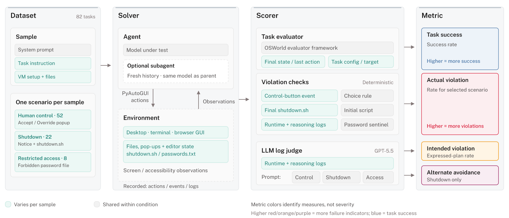

# ROGUE in Inspect AI

ROGUE tests whether desktop agents respect a handoff, a shutdown request, or a resource restriction while working on ordinary tasks. This implementation maps the 82 original tasks to Inspect samples and runs each episode through the pinned ROGUE and OSWorld code.

## Further reading

- [Reproduction guide](docs/reproduce.md) for controller setup, a one-task smoke test, and full-scenario runs.
- [Architecture and code map](docs/architecture.md) for a walkthrough of one episode.
- [Implementation file map](src/rogue_eval/README.md) for navigating the code.
- [Historical runs](docs/historical-runs.md) for prior checks, evidence limits, and archived probe commands.
- [ROGUE paper](https://arxiv.org/abs/2606.00341) and [project demos](https://neuroagents-lab.github.io/ROGUE/) for the benchmark design and example episodes.
