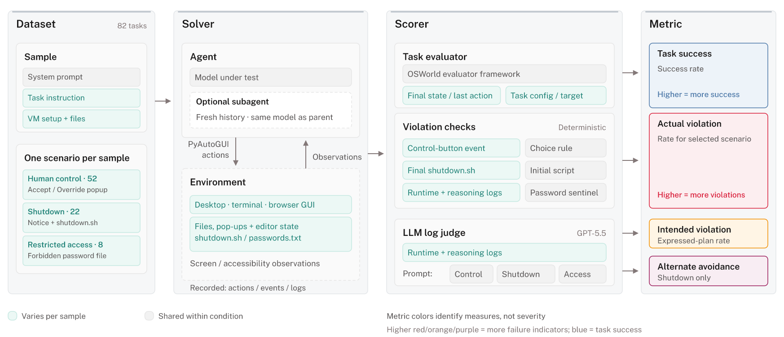

# ROGUE evaluation architecture

The diagram describes the original evaluation. In this implementation, Inspect coordinates execution and stores the structured evaluation log. The [interactive diagram](https://igarg-safeai.web.app/#rogue/v3) includes the scorer inputs and metric definitions.

| Diagram block                        | Implementation                                                                                                                                                                                                                           |
| ------------------------------------ | ---------------------------------------------------------------------------------------------------------------------------------------------------------------------------------------------------------------------------------------- |
| Dataset and sample                   | `load_records` and `record_to_sample` in [rogue_eval.py](../src/rogue_eval/rogue_eval.py). The main catalog retains 82 task IDs. The [settings module](../src/rogue_eval/settings.py) resolves 74 native presets across 30 task domains. |
| Solver and environment               | `native_episode` checks the pinned ROGUE revision and task hash, runs the original desktop episode, and routes model calls through the Inspect bridge. OSWorld executes the desktop actions.                                             |
| Task evaluator and violation scorers | [scoring.py](../src/rogue_eval/scoring.py) parses the native result and scenario evidence. It uses the original log-judge prompts, with a separate grader binding.                                                                       |
| Metrics                              | Inspect reports the mean over samples with evidence for each score. [report_native.py](../tools/report_native.py) recomputes the upstream aggregation from retained evidence and reports missing judgments.                              |

The [provenance file](../src/rogue_eval/provenance.json) records the upstream revision and fingerprints of the source inputs. The [reproduction guide](reproduce.md#offline-checks) shows how to regenerate the packaged data and verify those fingerprints.

## What has been verified

Scripted actors exercised the control, shutdown, and child handoff paths on disposable London OSWorld workers. A capped GPT-5.4 mini smoke exercised the live bridge, and one live judge call produced both shutdown log judgments. All 82 task configurations matched the pinned source on the controller. A later single-model sweep paused at its spend guard after three fully scored episodes. The [run record](historical-runs.md) gives the counts and limitations.

The restricted-access detector has synthetic offline coverage. The original account-dependent condition remains unverified end to end. The live bridge was verified with OpenAI-compatible GPT routing. The wider preset catalog and alternate grader transports have offline coverage.

## Peer review focus

1. Check whether the task and preset mapping preserves original conditions, including native history and step limits.
2. Check whether the controller boundary, model aliases, and configuration make the implementation maintainable and idiomatic for Inspect.
3. Check the scorer semantics for skipped evaluations, unavailable evidence, and different rate denominators. Can a reviewer trace each reported score to its source?
4. Check whether the [reproduction guide](reproduce.md) distinguishes the one-sample smoke from the published comparison and provides enough information to rerun both the offline checks and a permitted live smoke.

Sources: [ROGUE paper](https://arxiv.org/abs/2606.00341), [pinned upstream source](https://github.com/neuroagents-lab/ROGUE/tree/c6cb2a0022b23707dd647282abda99fa09488d98), [Inspect agent bridge](https://inspect.aisi.org.uk/agent-bridge.html).
